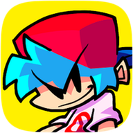

  

<h1 align="center">Uli Engine</h1>

  Cross-platform <b>Friday Night Funkin'</b> engine built on <b>Psych Engine 1.0.4</b> for <b>Windows (x64)</b> and <b>Android (64-bit &amp; 32-bit)</b>.

---

## Features
* **Cloud & Offline Local Wi-Fi (LAN) Multiplayer** — Play `1v1`, `2v2`, `3v3`, or `4v4` (`2–8` players + spectators) across Windows and Android with zero port-forwarding, or 100% offline over shared Wi-Fi / Mobile Hotspot.
* **Live Song & Mod Streaming** — Automatically streams only the active song (`modsCache/` Lite mode) or the full mod directly from the host with on-the-fly native compression, live Room Settings editing during transfers, and post-creation Room Password controls.
* **DJ Handoff, Custom Skins & Fair Play** — Delegate song selection (`DJ`) to any player in the lobby, equip custom character skins, chat with inline color emojis & speech bubbles, and balance asymmetric charts by Score, Accuracy, or Fewest Misses.
* **Multi-Engine Mod Compatibility (Enabled by Default)** — Native Psych Engine `1.0.4` / `0.7.x` / `0.6.x` support plus built-in **V-Slice** and **Codename Engine** compatibility layers, including smooth V-Slice Sustains & hold covers across engines.
* **In-Engine Mod Archive Importer** — Import `.zip`, `.rar`, `.7z`, `.tar`, and `.gz` mods directly from the Mods Menu on both PC and Android.
* **Visual Stage Creator Studio & Chart Recorder** — Modern dark studio with interactive 9-handle gizmo, live `16:9` / `20:9` camera framing simulator, one-click self-contained `MyExport` mod export on Android & PC, and a live `1K–9K` DAW-style Chart Recorder.
* **Native C++ Mod Optimizer** — Multi-threaded in-engine PNG quantizer (`1/2/4/8-bit` lossless packing + atlas rescaler) and streaming Ogg Vorbis VBR encoder with automatic `modsBackup/` safety.
* **Mobile, Controller & Low-RAM Hardware Tuning** — True `20:9` ultrawide widescreen, `1K–14K` touch hitboxes with dynamic note-skin colors & real-time shader sync, full Android/PC Gamepad + virtual UI cursor support, automatic GLSL ES shader transpilation, GPU texture caching (`cacheOnGPU`), and customizable zero-login Discord Rich Presence.
* **In-App Smart Updater** — Silent delta-patch updates on Windows and ABI-matched APK updates on Android.

---

## Downloads
Get the latest **Windows** (`LITE` / `FULL` / `patch`) and **Android** (`64-bit arm64` / `32-bit armv7`) builds from [**Releases**](https://github.com/xUsoCarrusoX3/Uli-engine/releases/latest).

---

## Credits

### Uli Engine
* **Mitu** — Project lead, multiplayer & LAN networking, mobile architecture, studio tools & native C++ optimization.

### Psych Engine & Upstream Contributors
* **Shadow Mario** — Main Programmer and Head of Psych Engine.
* **Riveren** — Main Artist and Animator of Psych Engine.
* **crowplexus**, **EliteMasterEric**, **MAJigsaw77**, **CheemsAndFriends**, **SqirraRNG**, **Keoiki**, **Kamizeta**, **MaxNeton**, **iFlicky**, **superpowers04**, **KadeDev**, **bbpanzu**.

### Friday Night Funkin'
* **The Funkin' Crew Inc.** (**ninjamuffin99**, **PhantomArcade**, **evilsk8r**, **Kawai Sprite**, and contributors) — Creators of the original **Friday Night Funkin'** game, characters, music, and artwork.

---

## License & Disclaimer
Uli Engine is an **unofficial, non-commercial fan project** built on **Psych Engine 1.0.4** and **Friday Night Funkin'** (Apache License 2.0), and is not affiliated with or endorsed by **The Funkin' Crew Inc.**

* **Upstream Engine Code (FNF & Psych Engine)**: Apache License 2.0.
* **Original Friday Night Funkin' Assets & Trademarks**: All Rights Reserved by **The Funkin' Crew Inc.** (excluded from Apache 2.0).
* **Uli Engine Original Modifications & Releases**: All Rights Reserved by Mitu (`xUsoCarrusoX3`); free for personal, non-commercial play and modding.

See [LICENSE](LICENSE) for full terms and third-party notices.
